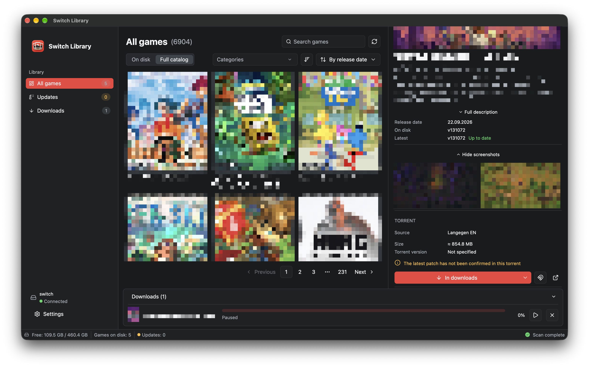

# Switch Library

**English** · [Українська](README.uk.md)

A native desktop app for organizing Nintendo Switch game archives. Browse your collection, check for known updates, and manage downloads in one place.

This repository hosts public releases and issue reports.

[Download releases](https://github.com/XpycT/switch-library-releases/releases) · [Report a bug](https://github.com/XpycT/switch-library-releases/issues/new?template=bug_report.md) · [Request a feature](https://github.com/XpycT/switch-library-releases/issues/new?template=feature_request.md)



## Features

- Scan NSP, NSZ, NSX, XCI, and XCZ archives recursively.
- Group base games, updates, and DLC by Title ID.
- Browse covers, screenshots, metadata, and local files with search and sorting.
- Compare known local versions with titledb to find available updates.
- Manage an embedded BitTorrent download queue with pause, resume, and file comparison before replacement.

The scanner does not decrypt archives or require console keys. Unknown local versions stay unknown; a newer version listed in titledb does not guarantee that a catalog download contains it.

## Downloads and installation

Open [Releases](https://github.com/XpycT/switch-library-releases/releases) and choose the file for your platform. If no releases are listed, public downloads have not been published yet. Filenames may differ; each release page lists the files it actually contains.

| Platform | File | Notes |
| --- | --- | --- |
| macOS / Apple Silicon | `Switch-Library-macos-arm64.zip` | For M-series Macs; does not run on Intel Macs |
| Windows / x64 | `Switch-Library-windows-x64.zip` | ZIP containing the executable |
| Linux / x86_64 | `Switch-Library-linux-x86_64.AppImage` | Built on Ubuntu 22.04, with a glibc 2.35 baseline |

macOS is the verified platform. Windows and Linux builds are untested on native hardware, and a build being available does not mean it runs on every desktop configuration.

### macOS

Extract the ZIP, move **Switch Library.app** to **Applications**, and open it.

Current builds are not Developer ID signed or notarized. If macOS blocks the app as being from an unidentified developer, follow Apple's [instructions for opening an app you trust](https://support.apple.com/en-us/102445): attempt to open it, then use **System Settings → Privacy & Security → Open Anyway**, if offered.

### Windows

Extract the ZIP and run `switch-library.exe`. No installer is required. The executable is not code-signed, so Windows may display a reputation warning.

### Linux

Make the downloaded AppImage executable and launch it:

```sh
chmod +x Switch-Library-linux-x86_64.AppImage
./Switch-Library-linux-x86_64.AppImage
```

If FUSE is unavailable, extract and run it with:

```sh
./Switch-Library-linux-x86_64.AppImage --appimage-extract-and-run
```

A Wayland or X11 desktop session, working Vulkan drivers, and a desktop portal with a backend appropriate to your desktop are required. AppImage packages application libraries but does not replace your graphics drivers or work on every Linux distribution.

## Getting started

1. Open the app and choose the folder containing your game archives.
2. Wait for the scan to finish, then browse your collection and check for known updates.
3. Open Settings to change the library folder, interface language, or catalog sources.

Changing the library folder leaves existing files where they are. Scanning never writes to archives. Replacing or deleting files happens only when you confirm it.

## Bugs and feature requests

Search [existing issues](https://github.com/XpycT/switch-library-releases/issues) before opening a new one. Use the bug report template for failures and the feature request template for improvements.

Include the application version, operating system, CPU architecture, and reproducible steps. Strip personal paths, credentials, and private download links from logs and screenshots. Do not attach game archives or console keys.
